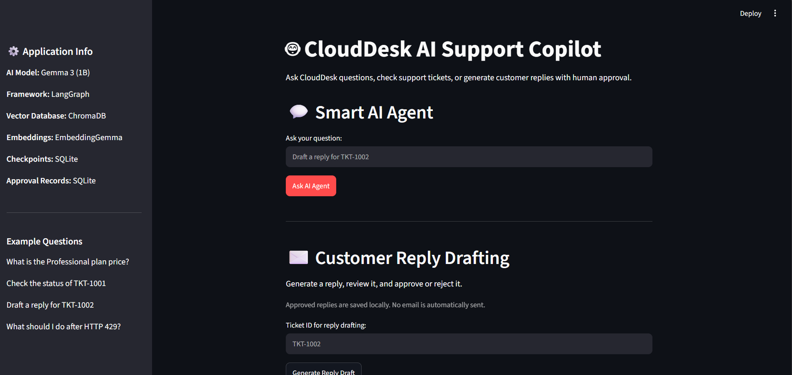
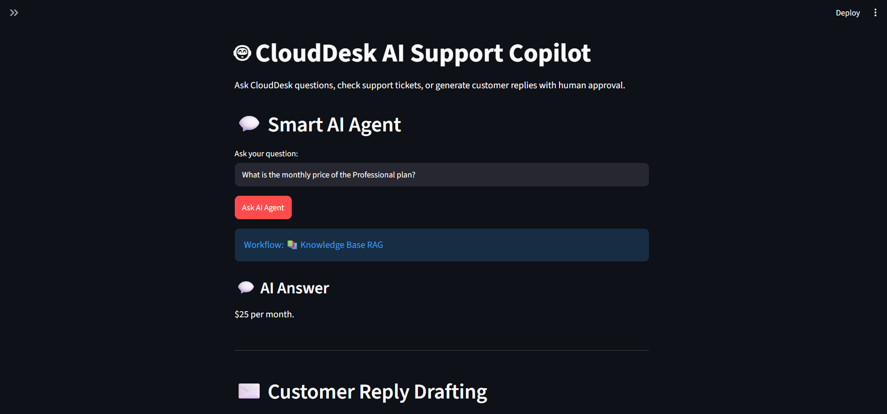
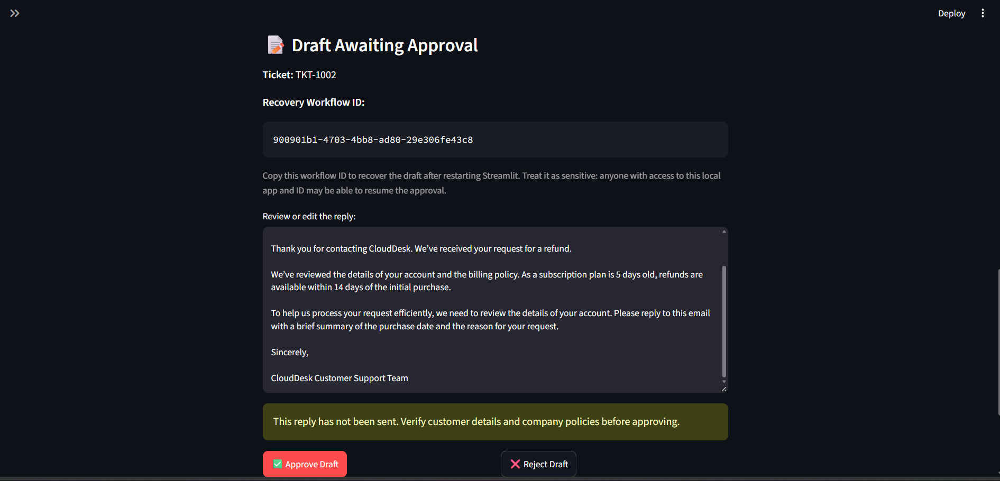
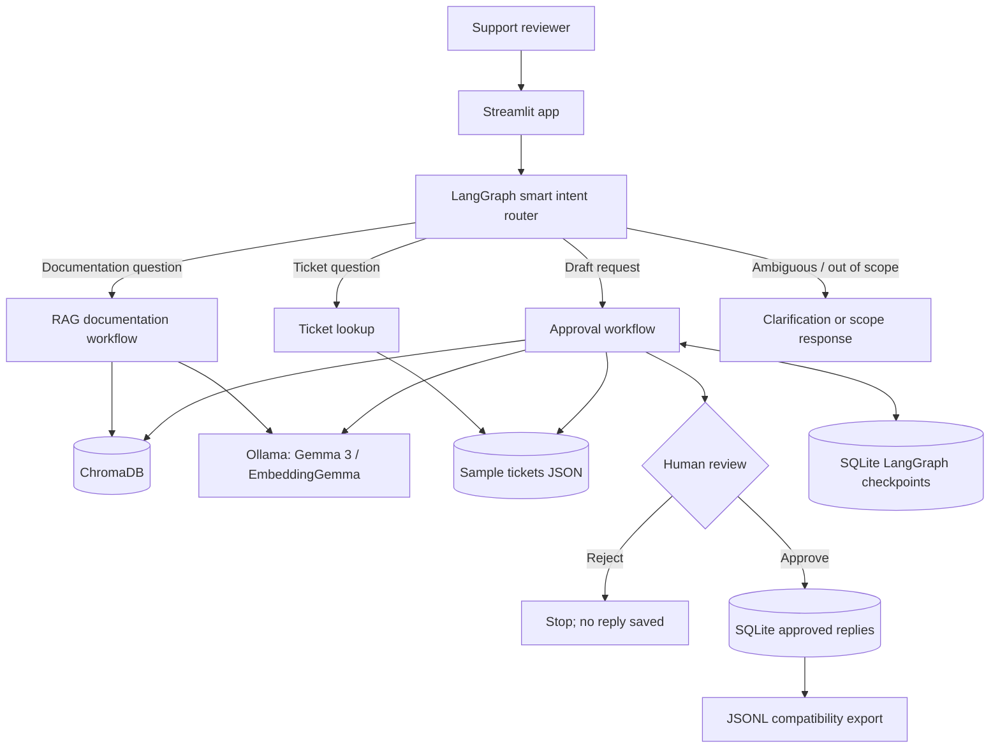

# CloudDesk AI Support Copilot

**A local-first, human-in-the-loop AI customer support copilot built with LangGraph, Ollama, ChromaDB, SQLite, and Streamlit.**

CloudDesk AI Support Copilot answers questions from fictional company policies, looks up sample support tickets, and drafts customer-facing replies for human review. It uses a smart intent router to select the appropriate workflow and saves approved replies locally **without sending email**.

> **Portfolio demonstration:** CloudDesk is a fictional company, and the included tickets and policies are sample data. This project is intended for local development and demonstration, not production deployment.

## Features

- **Smart intent routing:** Routes questions to documentation RAG, ticket lookup, reply drafting, clarification, or out-of-scope handling.
- **Retrieval-augmented generation (RAG):** Uses EmbeddingGemma embeddings and ChromaDB to retrieve relevant policy documents before generating answers.
- **Ticket lookup:** Reads fictional ticket records from `data/tickets.json`.
- **AI reply drafting:** Uses the local `gemma3:1b` model to draft customer-facing support responses grounded in ticket details and retrieved documentation.
- **Human-in-the-loop approval:** Reviewers can edit, approve, or reject a generated draft before it is saved.
- **Persistent workflow checkpoints:** LangGraph stores approval checkpoints in SQLite so interrupted approvals can be recovered after restarting Streamlit.
- **Duplicate-safe approval records:** A unique approval ID and a SQLite primary key prevent duplicate approval records when the same save is retried.
- **Local-first operation:** Runs with Ollama models on your machine; no OpenAI API key is required.
- **Evaluation scripts:** Includes routing, RAG, safety, and hallucination-oriented checks.


## Application Screenshots

### Streamlit Dashboard



### RAG Knowledge Base Answer



### Human-in-the-Loop Approval



## Detailed Architecture

See [System Architecture](docs/architecture.md)
for the full workflow diagram and component descriptions.


## Architecture



**Important:** The drafting workflow does **not** send emails. Approved replies are saved with status `approved_not_sent`.

## Technology stack

| Component | Technology |
| --- | --- |
| Web UI | Streamlit 1.66.1 |
| Agent orchestration | LangGraph 1.2.19 |
| Checkpoint persistence | langgraph-checkpoint-sqlite 3.1.3 |
| Vector database | ChromaDB 1.5.9 |
| Local model client | Ollama Python 0.6.3 |
| Generation and routing model | `gemma3:1b` |
| Embedding model | `embeddinggemma` |
| Approval record store | SQLite |
| Tested Python version | Python 3.13.1 |

## Project structure

```text
ai-support-copilot/
├── app.py                   # Streamlit interface and approval recovery
├── smart_agent.py           # Smart intent router
├── agent.py                 # Documentation RAG workflow
├── approval_agent.py        # Draft, interrupt, approve/reject, save
├── tools.py                 # Ticket lookup tool
├── ingest.py                # Document embedding and ingestion
├── data/
│   ├── account_guide.txt
│   ├── billing_policy.txt
│   ├── technical_support.txt
│   └── tickets.json
├── evaluate_agent.py        # Routing and safety evaluation
├── evaluate_rag.py          # RAG evaluation
├── test_smart_agent.py      # Smart router tests
├── test_duplicate_save.py   # SQLite idempotency check
├── test_hallucinations.py   # Hallucination-oriented checks
├── test_persistence.py      # Persistence checks
├── evaluation_results/      # Sample evaluation CSVs
├── requirements.txt
├── .gitignore
└── README.md
```

Additional test scripts are included in the repository. Local vector databases, SQLite files, generated approval exports, `.env`, and `.venv` are excluded from Git.

## Quick start (Windows PowerShell)

### 1. Prerequisites

- Python **3.13** (the project was tested with 3.13.1)
- [Ollama](https://ollama.com/) installed and running locally
- Git (for cloning the repository)

### 2. Clone and create a virtual environment

```powershell
git clone <YOUR-REPOSITORY-URL>
cd ai-support-copilot
py -3.13 -m venv .venv
.\.venv\Scripts\Activate.ps1
python -m pip install -r requirements.txt
```

Replace `<YOUR-REPOSITORY-URL>` with your GitHub repository URL after publishing.

### 3. Download local AI models

```powershell
ollama pull gemma3:1b
ollama pull embeddinggemma
ollama list
```

Ensure Ollama is running before continuing.

### 4. Build the knowledge base

```powershell
python ingest.py
```

This creates a local ChromaDB index from the sample policy documents. The generated `chroma_db/` directory is intentionally not committed to Git.

### 5. Start the app

```powershell
streamlit run app.py --server.port 8502
```

Open **http://localhost:8502** in your browser.

## Try these questions

| Input | Expected workflow |
| --- | --- |
| `What is the Professional plan price?` | Documentation RAG |
| `How long is a password reset link valid?` | Documentation RAG |
| `What should I do after HTTP 429?` | Documentation RAG |
| `Check the status of TKT-1001` | Ticket lookup |
| `Draft a reply for TKT-1002` | Draft + human approval |
| `Tell me about it` | Clarification |

The sample policies specify a Professional plan price of **$25/month**, a password-reset-link validity of **30 minutes**, and guidance to **wait before retrying** after HTTP 429.

## Human approval and recovery

1. Request a draft, such as `Draft a reply for TKT-1002`.
2. Review the generated text and edit it if needed.
3. Select **Approve Draft** to save the reply locally, or **Reject Draft** to discard it.
4. To test persistence, copy the **Recovery Workflow ID** while the draft is pending, restart Streamlit, and use **Recover Pending Approval** to reopen it.

The original generated draft and approval checkpoint can be recovered. **Unsaved edits made in the Streamlit text area are not restored** after a restart.

Approval records are stored in `approval_records.sqlite`, which is the authoritative record store. `approved_drafts.jsonl` is a compatibility export. The approval ID is unique in SQLite, so retrying the same save cannot create a second authoritative record. The JSONL export can be regenerated if needed.

## Evaluation and tests

The project includes scripts for routing, RAG, safety, and persistence checks. During local development, the following checks were reported as passing:

- **16/16** routing regression cases
- **3/3** safety checks
- **5/5** basic RAG factual/keyword checks
- **4/4** hallucination-oriented manual checks
- **8/8** smart-agent tests

These results are **local development checks**, not an independent benchmark or a guarantee of model accuracy. Some routing examples informed the router rules. Sample CSV reports are in `evaluation_results/`.

Run individual checks with:

```powershell
python test_smart_agent.py
python evaluate_agent.py
python evaluate_rag.py
python test_hallucinations.py
python test_duplicate_save.py
```

**Note:** `test_duplicate_save.py` writes a synthetic approval record to the local SQLite database and refreshes the JSONL export. Run it against development data, not a production record store.

## Safety and limitations

- **Human approval is required** before saving a drafted customer reply. Saving is **not** sending.
- The system is grounded in a small set of fictional policy documents; retrieval and model outputs can still be wrong. Review all drafts before use.
- The application has **no authentication, role-based access control, or per-user authorization**. Workflow IDs are not access credentials and should be treated as sensitive.
- Local SQLite checkpointing and JSONL export are suitable for a single-user demonstration, **not a hardened multi-process production service**.
- Checkpoint recovery restores the generated draft, not unsaved text-area edits.
- The `requirements.txt` file pins direct dependencies, but it is **not a complete lockfile** for all transitive dependencies.
- No automated email integration, production monitoring, or live customer-support backend is included.

## Future improvements

- Authentication, authorization, and reviewer audit logs
- Automated end-to-end tests in a clean environment
- Better evaluation datasets and retrieval-quality metrics
- Multi-user persistence and transactional export/outbox handling
- Containerized deployment and CI checks

## License

No license has been selected yet. Add a `LICENSE` file before inviting reuse or contributions.
