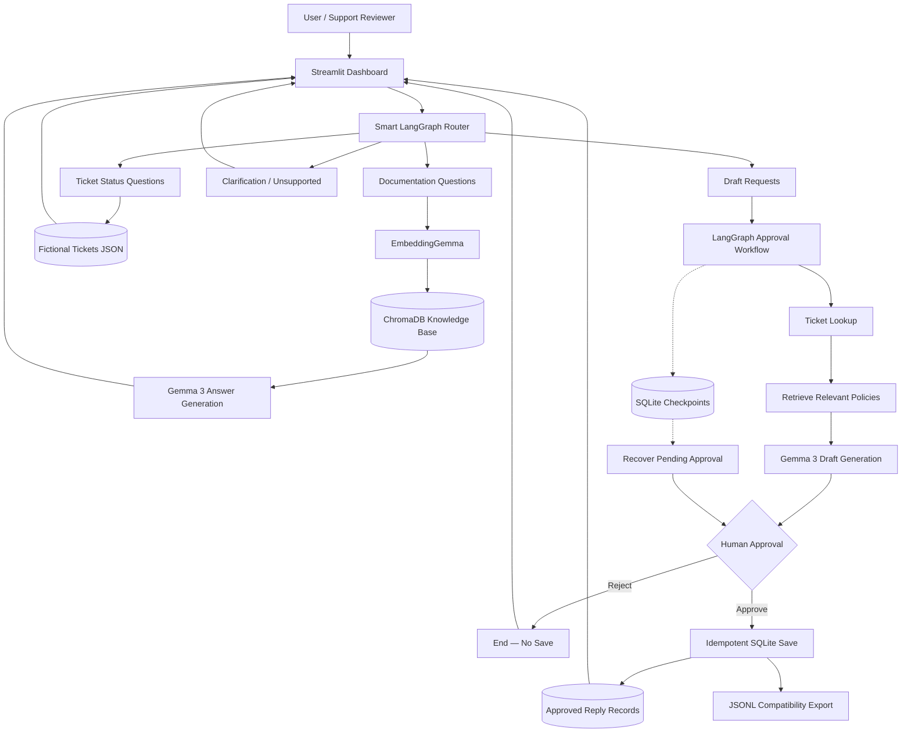

# CloudDesk AI Support Copilot — Architecture

## Key Components

- **Streamlit:** User-facing application and approval interface.
- **Smart LangGraph Router:** Classifies requests and selects a workflow.
- **Ollama / Gemma 3:** Runs local language-model inference.
- **EmbeddingGemma:** Produces document and query embeddings.
- **ChromaDB:** Stores and retrieves company-policy documents.
- **Ticket Lookup:** Reads fictional customer support tickets.
- **Human Approval:** Interrupts drafting until a reviewer approves or rejects.
- **SQLite Checkpoints:** Persist workflow state across application restarts.
- **SQLite Approval Records:** Prevent duplicate saves using unique approval IDs.
- **JSONL Export:** Provides a local export of approved replies.

## Safety Boundaries

- No automatic email sending.
- Human approval is required before a draft is saved as approved.
- Approved replies have the status `approved_not_sent`.
- Local databases and approval records are excluded from Git.
- This is a portfolio demonstration, not a production customer-support deployment.
